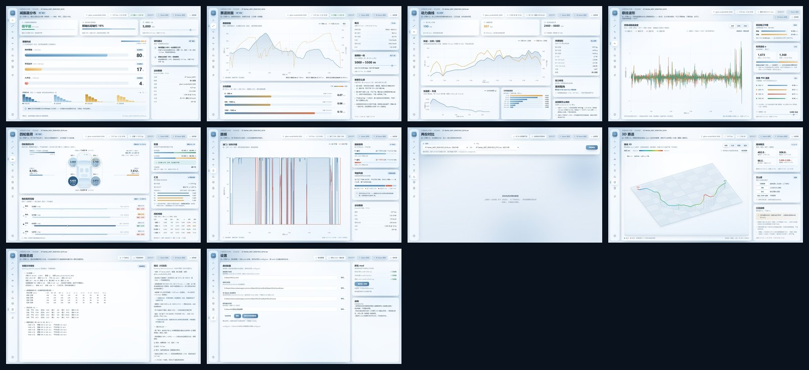
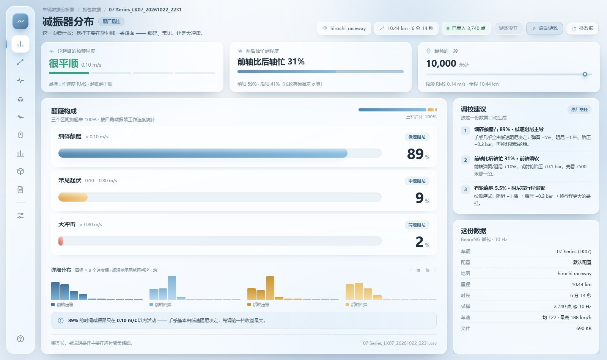
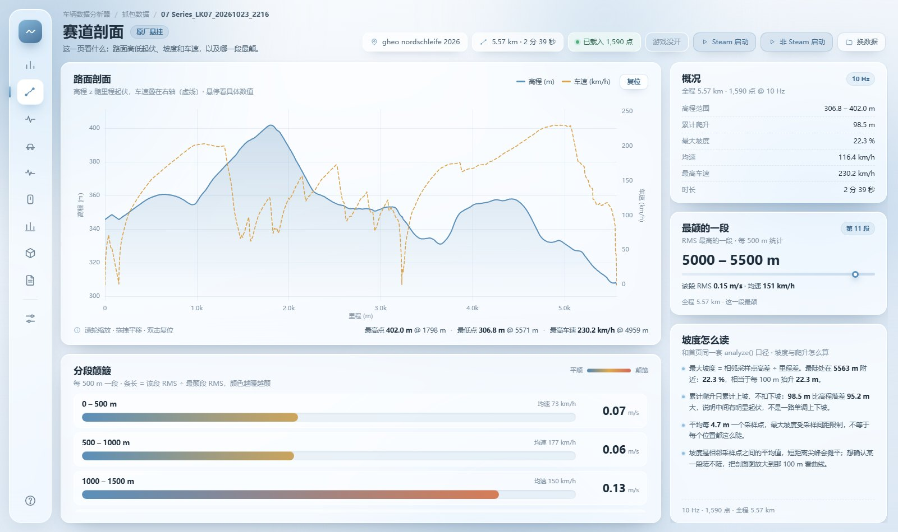
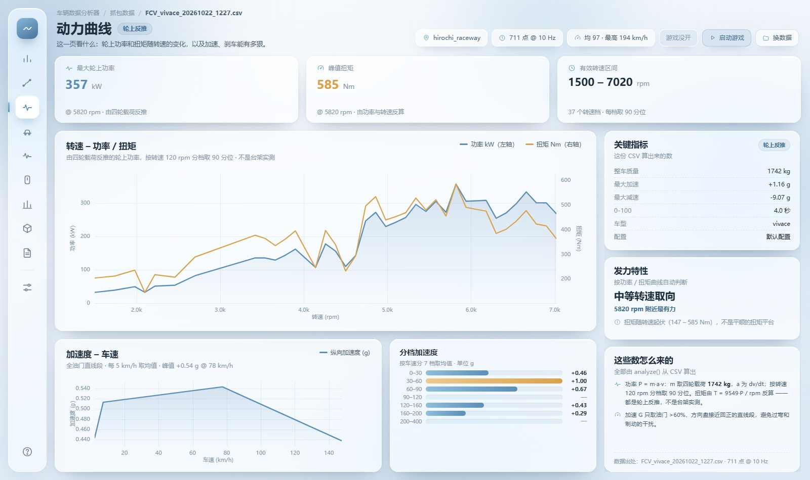
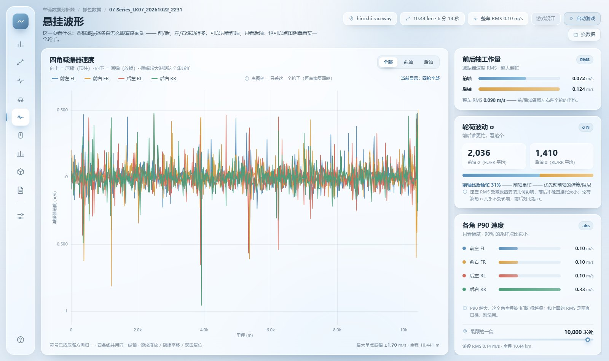
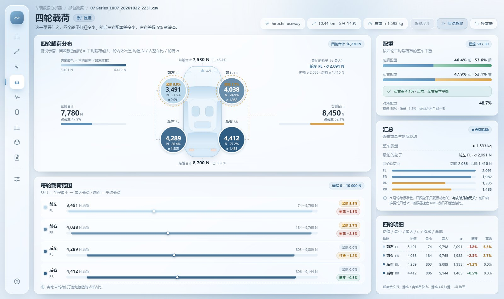
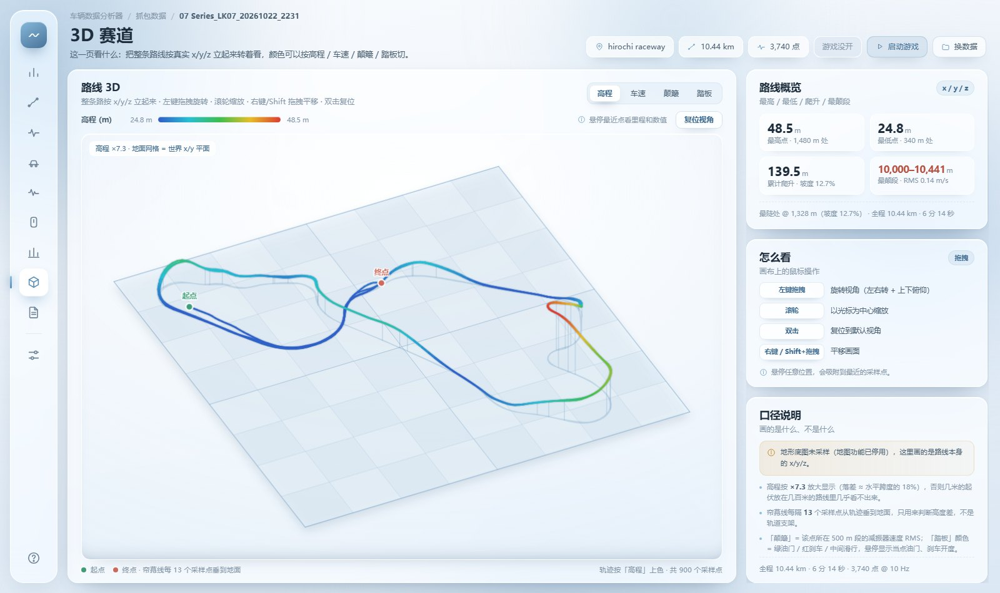
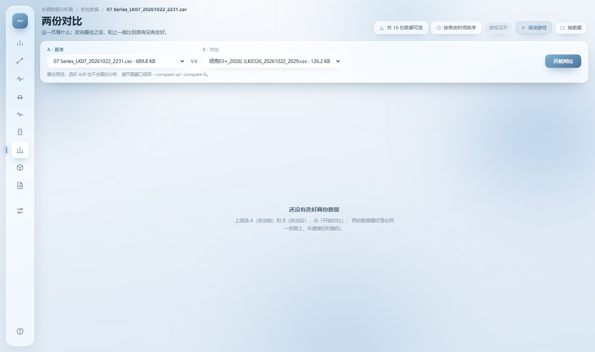
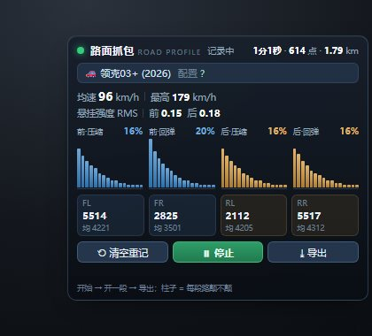

# 车辆数据分析器（BeamNG 跑图数据采集 · 悬挂调校助手）

**[⬇️ 下载 Release（Windows 安装包）](https://github.com/xiake08/beamng-vdata-analyzer/releases/latest)**

读取 BeamNG.drive 游戏内导出的跑图 CSV，把减振器、轮荷、踏板、路线这些数据算成
**一眼能看懂的图和结论**，帮你调悬挂而不是凭感觉。

> 界面是 pywebview + HTML/CSS 手写的 BeamNG 风格 Web UI，纯本地运行、不联网。



## 功能

- **减振器分布**：三档颠簸占比（细碎 / 常见 / 大冲击）+ 前后轴谁更忙 + 自动调校建议
- **赛道剖面**：高程、坡度、车速沿里程展开，最颠路段自动标出
- **动力曲线**：轮上功率 / 扭矩、加速度-车速、分档加速度、0-100 与滚动加速（60-100 / 80-120 / 100-150）
- **悬挂波形**：四轮减振器速度曲线同屏，可点图例只看单个轮子
- **四轮载荷**：车模俯视图 + 配重分析 + 每轮载荷范围
- **踏板**：油门 / 刹车开度曲线与驾驶风格判断
- **两份对比**：A/B 两份数据对比好坏（改前 / 改后）
- **3D 赛道**：按真实 x/y/z 立起来看，可旋转 / 缩放 / 悬停读数
- **数据总结**：大白话结论 + 可复制的完整报告
- **换数据 / 删抓包**：自动识别新抓包，3 秒一刷新
- **一键启动游戏 / 一键安装抓包 mod**

| | |
|---|---|
|  |  |
|  |  |
|  |  |
|  |  |

## 快速开始

### 方式 A：直接用安装包（Windows）

1. 下载 Release 里的 `车辆数据分析器_v2.0_安装程序.exe`
2. 双击安装（安装路径**不要带空格**），安装程序会自动创建桌面快捷方式
3. 打开后到「设置」里填三个路径：游戏用户目录、游戏主程序、抓包输出目录

### 方式 B：源码运行

```bash
pip install pywebview pillow
python web_ui.py
```

需要 Python 3.10+、Windows 10/11（WebView2 运行时一般系统自带）。

## 数据从哪来

游戏内的抓包扩展在 `roadProfile.lua`（配合 `modScript.lua` 自动加载）；
`roadProfileUI.zip` 是游戏内「路面抓包」面板（UI Apps 里打开，Ctrl+U）。

流程：安装 mod → 重启游戏 → UI Apps 里打开「路面抓包」→ 点「开始」→ 跑一段 → 点「导出」→
分析器右上角「换数据」就能看到新 CSV（程序每 3 秒自动检测）。

CSV 是 10 Hz 采样，每条包含时间、x/y/z、车速、四轮载荷、踏板、方向盘等字段。

## 3D 底图说明

3D 赛道页默认画的是路线本身的 x/y/z + 地面网格。真实地图 / 地形采样 / 游戏截图导入
这几版都试过，由于游戏地图是实时渲染、离线拿不到，最终按用户要求回滚到网格版本；
相关代码（`level_map.py`、`p_map3d.py` 里的地图绘制）保留但默认关闭。

## 目录结构

```
web_ui.py                主程序 / 页面框架 / pywebview 窗口
beamng_data.py           数据引擎（读 CSV、算指标、结论、装 mod、启动游戏）
install_actions.py       mod 安装 / 启动游戏辅助
level_map.py             真实地图合成（实验用，默认关闭）
webui_parts/             页面模块（profile/dyno/wheels/wave/pedals/compare/map3d/summary/settings/help）
tools/installer_gui.py   安装程序源码
tools/uninstaller.py     卸载程序源码
roadProfile.lua          游戏内抓包扩展
modScript.lua            自动加载脚本
roadProfileUI.zip        游戏内「路面抓包」面板 mod
config.example.json      配置文件示例（复制成 config.json 再改）
```

## 构建

```bash
# 主程序（构建目录不要带空格，pythonnet 在带空格路径下会加载失败）
pyinstaller --onedir --windowed --name 车辆数据分析器 --icon app.ico ^
  --add-data "webui_parts/chartkit.js;webui_parts" ^
  --collect-submodules webui_parts --collect-all webview ^
  --collect-all pythonnet --collect-all clr_loader --collect-all cffi ^
  --exclude-module level_map --exclude-module numpy ^
  web_ui.py

# 安装程序（app.zip 里放主程序产物 + 卸载.exe + 支持文件）
pyinstaller --onefile --windowed --name 车辆数据分析器_v2.0_安装程序 ^
  --icon app.ico --add-data "app.zip;." --add-data "app.ico;." installer_gui.py

# 卸载程序
pyinstaller --onefile --windowed --name 卸载 --icon app.ico uninstaller.py
```

## 配置文件

`config.json`（不要提交到仓库，已在 `.gitignore` 里）：

```json
{
  "userpath": "D:\\BeamNG\\current",
  "game_exe": "E:\\SteamLibrary\\steamapps\\common\\BeamNG.drive\\Bin64\\BeamNG.drive.x64.exe",
  "outdir": "D:\\BeamNG\\captures"
}
```

## 免责声明

- 本项目与 BeamNG GmbH 无关，仅读取游戏导出的数据文件。
- 抓包扩展只读取车辆状态、不修改游戏本体；安装 mod 前请自行备份存档。
- 行车数据、调校建议仅供参考，不对实际车辆设置负责。

## License

MIT，见 [LICENSE](LICENSE)。
